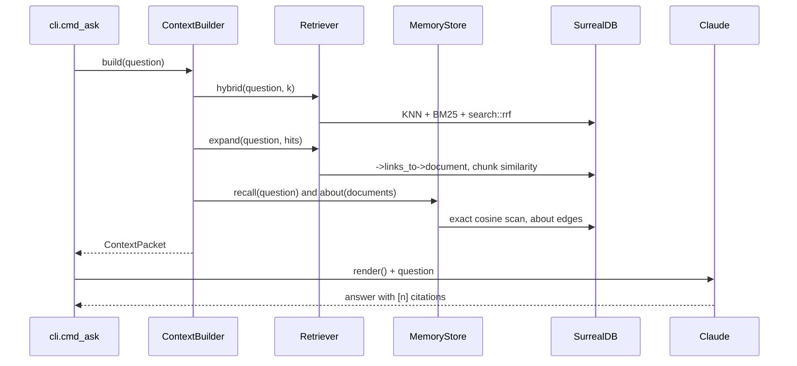
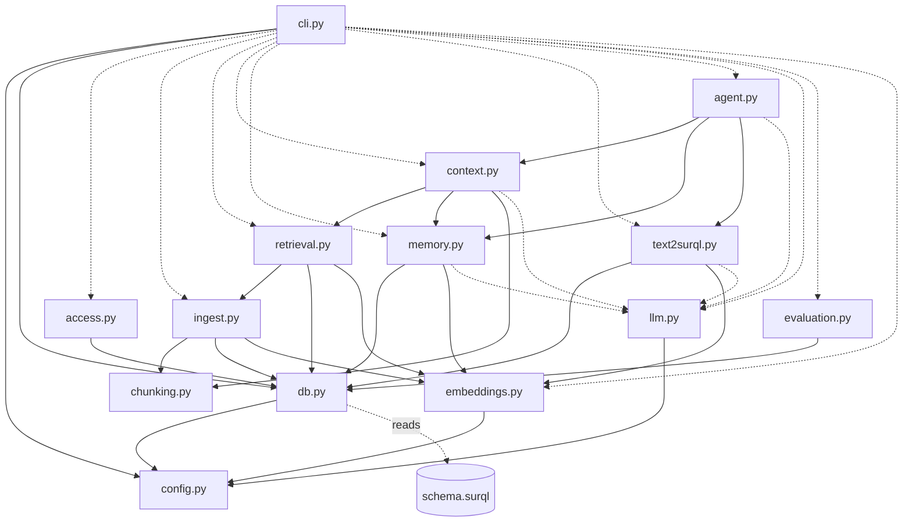

# Code flow

How execution moves through the code: where it starts, what runs in what order, and which function calls which. File paths are relative to `src/contextlayer/` unless they say otherwise.

Read it top to bottom the first time: sections 1–3 cover how a command starts, section 4 follows each command, and section 5 goes deep into the five core flows the commands share.

---

## 1. Entry points

There are three ways into the code.

| Entry point | Defined in | What starts |
|---|---|---|
| `ctx <command>` | `pyproject.toml`: `[project.scripts] ctx = "contextlayer.cli:main"` | `cli.main()` |
| `import contextlayer` | `__init__.py` | Nothing runs; the package re-exports the main classes for library use |
| `pytest` | `pyproject.toml`: `testpaths = ["tests"]` | `tests/conftest.py` fixtures, then the test files |

`uv sync` installs the package in editable mode and creates the `ctx` script, so `uv run ctx ...` runs `cli.main()` directly against the source in `src/`.

---

## 2. What happens at import time

Before any function runs, importing modules has two side effects:

1. **`config.py` calls `load_dotenv()`** at import. Every `KEY=value` in `.env` is copied into the process environment. `Settings` reads the environment later, each time a `Settings()` is created (its fields use `default_factory`).
2. **`db.py` loads nothing yet.** The schema file is read only when `Database.apply_schema()` runs.

`cli.py` imports only `config` and `db` at the top. Every other module is imported inside the command function that needs it. That keeps `ctx --help` fast and means, for example, that `ctx search` never imports `anthropic`.

---

## 3. `cli.main()`: from command line to command function

```
main(argv)
├── sys.stdout.reconfigure(encoding="utf-8")       # Windows consoles default to cp1252
├── argparse: build the parser and the subcommands
│     each subcommand calls p.set_defaults(fn=cmd_<name>)
├── args = parser.parse_args(argv)
└── args.fn(args)                                   # dispatch to the command
      └── on EmbedderMismatch: print the message and exit(1)
```

| Command | Function | Needs an API key |
|---|---|---|
| `ctx init` | `cmd_init` | no |
| `ctx ingest [DIR]` | `cmd_ingest` | no |
| `ctx search "q"` | `cmd_search` | no |
| `ctx context "q"` | `cmd_context` | no |
| `ctx ask "q"` | `cmd_ask` | yes |
| `ctx sql "q"` | `cmd_sql` | yes |
| `ctx chat` | `cmd_chat` | yes |
| `ctx memory <action>` | `cmd_memory` | no |
| `ctx users` | `cmd_users` | no |
| `ctx eval` | `cmd_eval` | no |
| `ctx reset` | `cmd_reset` | no |

### Helpers every command uses

```
_settings(args, **overrides)
└── Settings()                         # reads SURREAL_*, CL_* from the environment
    └── dataclasses.replace(...)       # applies --db, --ns, --embedder and overrides

_embedder(settings)
└── embeddings.get_embedder(kind, model)        # cached with lru_cache
    ├── "fastembed" → FastEmbedEmbedder(model)  # loads the ONNX model (downloads once)
    └── "hash"      → HashEmbedder()

_connect(args)
├── with --user: access.connect_as_user(email, password, settings)
│     ├── Database.connect(settings, signin=False)   # anonymous connection
│     └── db.signin_record("account", email=..., password=...)
│           └── SurrealDB runs the SIGNIN clause of DEFINE ACCESS account (schema.surql)
└── otherwise:   Database.connect(settings)          # root user from settings

Database.connect(settings)
├── Surreal(settings.surreal_url)      # SDK picks the WebSocket client for ws://
├── conn.signin({username, password})
└── conn.use(namespace, database)

_retriever(args, db)  → Retriever(db, embedder, strategy)   # runs db.check_embedder()
_memory_store(args, db)
├── owner = db.one("RETURN $auth.id")  # only when --user was given
└── MemoryStore(db, embedder, agent, owner)                 # runs db.check_embedder()
_builder(args, db)    → ContextBuilder(_retriever(...), _memory_store(...), k, expand_graph)
```

---

## 4. Command by command

### `ctx init`

```
cmd_init
├── _settings → _embedder
├── Database.connect(settings)
├── DEFINE NAMESPACE / DEFINE DATABASE IF NOT EXISTS
├── db.apply_schema(embedder)
│   ├── read schema.surql (importlib.resources)
│   ├── replace {{EMBEDDING_DIM}} with embedder.dim
│   ├── db.query(schema)                       # tables, indexes, access, functions
│   └── db.check_embedder(embedder, record=True)
│         └── first run: UPSERT meta:embedding {model, dim}
│             later runs: raise EmbedderMismatch if the model differs
└── TextToSurql(db, None, embedder).load_examples(data/surql_examples.json)
    ├── embedder.embed(all example questions)
    └── DELETE surql_example; INSERT INTO surql_example ...
```

### `ctx ingest`

```
cmd_ingest
├── ingest.load_directory(path)
│   ├── parse_markdown(file) for every **/*.md        # see 5.1
│   └── raise if two files share a slug
├── Ingestor(db, embedder, [strategy])                  # check_embedder
└── Ingestor.ingest_all(docs, prune=not --keep)         # see 5.1
```

### `ctx search "question"`

```
cmd_search
├── _connect → _retriever
└── for mode in vector, fulltext, hybrid, hybrid_graph (or just --mode):
    └── getattr(retriever, mode)(question, k)           # see 5.2
        └── print each Hit: score, chunk id, title, "via" for graph hits
```

### `ctx context "question"`

```
cmd_context
├── _connect → _builder
├── ContextBuilder.build(question)                      # see 5.3
└── print packet.render() and a summary line
```

### `ctx ask "question"`

```
cmd_ask
├── _connect → _builder
├── context.answer(question, builder, ClaudeLLM())
│   ├── builder.build(question)                         # see 5.3
│   ├── prompt = packet.render() + <question>
│   └── llm.text(system=ANSWER_SYSTEM, prompt)
│       └── ClaudeLLM.create → client.beta.messages.create(...)
│             └── raise RefusalError if stop_reason == "refusal"
└── print the answer, then each source, marking the ones Answer.cited finds
```



### `ctx sql "question"`

```
cmd_sql
├── _connect
├── _text_to_surql(args, db, ClaudeLLM())
│   ├── admin = Database.connect(settings)              # root, to read the schema
│   └── executor =
│         with --user: the user's own connection (their permissions apply)
│         otherwise:   Database.connect_database_user(*access.ensure_viewer(admin))
│                        └── DEFINE USER ctx_reader ... ROLES VIEWER
├── TextToSurql.ask(question)                           # see 5.5
└── print failed attempts, the query, and the rows as JSON
```

### `ctx chat`

```
cmd_chat
├── _connect → _builder
├── builder.memory.reconciler = memory.llm_reconciler(llm)
├── ContextAgent(llm, builder, builder.memory, _text_to_surql(...), on_tool=show)
└── loop: input() → agent.send(message) → print reply      # see 5.6
    (an empty line exits)
```

### `ctx memory <action>`

```
cmd_memory
├── _connect → _memory_store
└── by action:
    ├── remember → MemoryStore.remember(text, subject, attribute, valid_from, replaces, ttl)   # 5.4
    ├── recall   → MemoryStore.recall(text, k, as_of, known_at)                              # 5.4
    ├── lookup   → MemoryStore.lookup(subject, attribute, as_of, known_at)
    ├── history  → MemoryStore.history(subject, attribute)
    ├── lineage  → MemoryStore.lineage(memory_id)       # follows ->supersedes-> recursively
    ├── list     → MemoryStore.all(include_superseded)
    └── erase    → MemoryStore.forget_user()            # memories + turns
    each memory is printed by _print_memory, which labels it current / ended / upcoming
```

### `ctx users`

```
cmd_users
├── read data/users.json
└── access.create_user(db, email, name, password, teams) for each
      └── UPDATE the user if the email exists, else CREATE; password = crypto::argon2::generate
```

### `ctx eval`

```
cmd_eval
├── evaluation.load_golden(data/golden.json)            # slugs → "document:<slug>"
├── ingest.load_directory(data/corpus)
├── for each strategy (section, fixed, sentence, parent_child):
│   ├── database "<db>_eval_<strategy>": REMOVE, then DEFINE   # one strategy per database
│   ├── db.apply_schema(embedder)
│   ├── Ingestor(db, embedder, [strategy]).ingest_all(docs)
│   ├── retriever = Retriever(db, embedder, strategy)
│   └── for each retriever mode (vector, fulltext, hybrid, hybrid_graph):
│       └── evaluation.evaluate(name, retrieve, golden, k)
│           └── for each golden question:
│               ├── retrieve(q) = rank_documents(getattr(retriever, mode)(q, 3k))[:k]
│               └── recall_at_k, precision_at_k, reciprocal_rank
│                     (or fn::recall_at_k, ... in SurrealQL when db= is passed)
├── print format_reports(reports)
└── with --misses: list every question with recall below 1
```

### `ctx reset`

```
cmd_reset → REMOVE DATABASE IF EXISTS <db>
```

---

## 5. The core flows

### 5.1 Ingestion: file → document, chunks, embeddings, links

```
load_directory(dir)
└── parse_markdown(path)                    for every **/*.md, sorted
    ├── split YAML front matter (_FRONT_MATTER regex) → yaml.safe_load
    ├── _plain(metadata)                     # dates → ISO strings (the SDK can't encode date)
    └── SourceDocument(slug, title, content, kind, tags, visibility, team, ...)
          ├── .links       → [[slug|label]] targets, in order, without duplicates
          └── .plain_text  → content with wikilinks replaced by their labels

Ingestor.ingest_all(docs, prune)
├── for each doc: Ingestor.ingest(doc)
│   ├── for each strategy: _chunk_rows(doc, doc_id, strategy)
│   │   ├── chunking.chunk(doc.plain_text, strategy) → STRATEGIES[strategy]
│   │   │     section      → sections() then sentence() for sections over 400 tokens
│   │   │     sentence     → _units() → pack units up to max_tokens
│   │   │     fixed        → word windows with overlap
│   │   │     parent_child → sections() → one parent + sentence() children each
│   │   ├── text = "<title>\n<chunk>"
│   │   ├── embedder.embed(texts of searchable chunks)        # parents are not embedded
│   │   └── rows with id chunk:<slug>.<strategy>.<position>, parent link for children
│   └── db.query(one transaction):
│         UPSERT document; DELETE stale chunks; UPSERT each chunk
├── for each doc: Ingestor.link(doc)                    # second pass: all targets now exist
│   └── transaction: DELETE links_to WHERE in = doc;
│                    INSERT RELATION links_to for targets that exist
└── prune: DELETE chunks and documents not in this run
```

### 5.2 Retrieval

All four retrievers end in `_hits(rows, ...)`, which turns database rows into `Hit` objects (chunk id, document id, title, kind, text, score, parent_text, signals).

```
Retriever.vector(query, k)
├── embedder.embed_query(query)
├── exact=True: one SELECT computing vector::similarity::cosine for every chunk
└── otherwise: _knn("hits", candidates) + SELECT ... FROM $hits LIMIT k
      _knn = LET $nn = KNN over all chunks (no filter, over-fetched)
             LET $hits = $nn filtered by strategy/kind, ORDER BY distance, id

Retriever.fulltext(query, k)
└── SELECT ... WHERE text @1,OR@ $q  ORDER BY search::score DESC, id  LIMIT k

Retriever.hybrid(query, k)
├── fusion="python": _hybrid_python → vector(...) + fulltext(...) → RRF by hand
└── builtin (default), in one query:
      _knn("vs") → $vs (vector candidates)
      $ft        (BM25 candidates)
      $fused = search::rrf([$vs, $ft], ...)
      SELECT ... FROM $fused ORDER BY rrf_score DESC, id LIMIT k

Retriever.expand(query, hits, depth, per_hop, seeds)
├── frontier = top `seeds` documents in hits
└── for hop in 1..depth:
    ├── SELECT ->links_to->document FROM frontier    # (or <- / <->)
    ├── for the new candidate documents: chunks ranked by cosine similarity
    ├── keep, per source document, its best `per_hop` neighbours
    │     (each with up to chunks_per_doc chunks, tagged hops and via)
    └── frontier = the kept documents

Retriever.hybrid_graph(query, k)
├── hits = hybrid(query, max(2k, 10))
├── expanded = expand(query, hits)
└── return seed-document hits + expanded + the remaining hits

rank_documents(hits) → document ids in first-appearance order   # used by eval
```

### 5.3 Context assembly

```
ContextBuilder.build(question)
├── retrieve(question)
│   ├── hits = getattr(retriever, mode)(question, k)     # mode defaults to hybrid
│   ├── split into kept / dropped with _relevant(hit)
│   │     kept if distance ≤ max_distance or bm25 ≥ min_bm25
│   └── if expand_graph: kept += retriever.expand(question, kept, depth)
├── memories:
│   ├── memory.recall(question, k, reinforce=False)      # similarity floor applies
│   └── memory.about(documents in the hits)              # memories linked by ->about->
├── fit memories into token_budget × memory_share; the rest → dropped_memories
├── for each hit, in rank order:
│   ├── text = hit.generation_text                       # the parent section if any
│   ├── skip text already used (two children of one parent)
│   ├── too big? fall back from parent to the child's own text
│   ├── still too big? → dropped
│   └── append to that document's Source (numbered 1, 2, 3, ... by first appearance)
└── ContextPacket(question, sources, memories, tokens, dropped, dropped_memories)

ContextPacket.render()
└── <memories> ... </memories> and <source index="n" id=... title=...> text </source> blocks
```

### 5.4 Agent memory

```
MemoryStore.remember(content, subject, attribute, valid_from, replaces, ...)
├── embedding = embedder.embed([content])
├── neighbours = _current_neighbours(embedding, subject, attribute)
│     the slot's current values (with a slot), or the 3 nearest current memories
├── nearest within dedupe_distance → _reinforce(it) → WriteResult("reinforced")
├── supersede = replaces
│     + every current value in the slot          (slot given)
│     or the reconciler's verdict per neighbour  (no slot; only within conflict_distance)
│        "duplicate" → _reinforce → return
│        "supersede" → add to the list
├── db.query(one transaction):
│     CREATE memory {..., valid_from, source_turn, confidence, expires_at}
│     for each old memory: set valid_until and superseded_at; RELATE new->supersedes->old
├── about=[...] → INSERT RELATION about (memory → document)
└── WriteResult("created" | "superseded", id, superseded ids)

MemoryStore.recall(query, k, as_of, known_at)
├── _AT_TIME: $t_valid = as_of or now; $t_known = known_at or now
├── $candidates = this agent's and owner's memories passing _IN_TIME,
│                 with exact cosine similarity and recency
├── $ranked = similarity ≥ min_similarity, ordered by
│             0.6·similarity + 0.2·recency + 0.2·importance, LIMIT k
├── reinforce (only when asked, and only for the present):
│     access_count + 1, last_accessed = now, importance + step
└── [Memory(...)] via _memory(row)

lookup / history / lineage / about / all   → single queries over the same table
forget_user  → DELETE memory and turn rows for this agent and owner
log_turn     → CREATE turn {session, role, content}; returns its id for provenance
llm_reconciler(llm) → judge(existing, new) → llm.json(JUDGE_SYSTEM, ...)["verdict"]
```

### 5.5 Text-to-SurrealQL

```
TextToSurql.ask(question, max_attempts=3)
├── system = SYSTEM with self.schema
│     schema (cached) → schema_prompt(db)
│       └── INFO FOR DB, then INFO FOR TABLE for each table not excluded;
│           strips PERMISSIONS, embedding/password fields and HNSW indexes
└── up to 3 times:
    ├── prompt = build_prompt(question, failures)
    │     ├── examples_for(question) → KNN over surql_example (3 closest)
    │     └── one <failed_attempt> per earlier failure
    ├── out = llm.json(system, prompt, OUTPUT_SCHEMA)      # {query, explanation}
    └── run(out["query"])
        ├── check_query(query, exclude)    # one SELECT, no write keywords, no
        │                                  # http::/crypto::, no excluded tables
        ├── append TIMEOUT 2s if absent
        └── executor.one(query) → rows (cut to max_rows)
        on GuardrailError / QueryError → add (query, error) to failures, retry
→ SurqlResult(question, query or None, rows, explanation, failures)
```

### 5.6 The agent loop

```
ContextAgent.send(message)
├── self._turn_id = memory.log_turn(session, "user", message)     # provenance
├── messages.append(user: _with_memories(message))
│     └── memory.recall(message, k=3, reinforce=False) prepended as <memories_about_user>
└── up to max_steps (8) times:
    ├── response = llm.create(system=SYSTEM, messages, tools=TOOLS)
    ├── messages.append(assistant: response.content)
    ├── stop_reason != "tool_use":
    │     memory.log_turn(session, "assistant", text) → return Turn(text, tool calls)
    └── for each tool_use block: run_tool(name, input)
        ├── search_knowledge(query)         → context.build(query) → <document> blocks   (5.3)
        ├── query_database(question)        → sql.ask(question) → JSON of query + rows   (5.5)
        ├── recall_memory(query, as_of)     → memory.recall(query, as_of)                (5.4)
        └── remember(content, kind, importance, subject, attribute, valid_from)
                                            → memory.remember(..., source_turn=_turn_id) (5.4)
        a tool error becomes a tool_result with is_error=True (the loop doesn't crash)
        all results go back in ONE user message, then the loop continues
```

---

## 6. Module dependencies

Arrows point from the importer to the module it imports. Dashed arrows are imports made inside functions (`cli.py`) or for type hints only (`LLM`).



`db.py` is the foundation: almost everything goes through `Database.query()` / `Database.one()`, which wrap the SDK's `query_raw()` (decision 2.1 in `decisions.md` explains why).

---

## 7. How the tests run

```
pytest
└── tests/conftest.py fixtures, in dependency order:
    ├── surreal_url   (once per session)
    │     SURREAL_TEST_URL if set, else start `surreal start memory` on a free port,
    │     wait for the port, stop the server at the end
    ├── settings      fresh database name per test, embedder = "hash"
    ├── embedder      HashEmbedder()
    ├── db            Database.connect → DEFINE DATABASE → apply_schema(embedder)
    │                 ... test runs ... → REMOVE DATABASE
    └── corpus_db     db + Ingestor(db, embedder, ["section"]).ingest_all(data/corpus)
```

| Test file | Exercises |
|---|---|
| `test_chunking.py` | `chunking.py` pure functions (no database) |
| `test_retrieval.py` | `ingest.py`, `retrieval.py`, embedder check, pruning, parent/child |
| `test_memory_and_access.py` | `memory.py` recall, `access.py` permissions, `context.py` budget and rendering |
| `test_memory_history.py` | corrections, `as_of`, `known_at`, retractions, reconciler, provenance |
| `test_text2surql_and_agent.py` | guardrails, schema prompt, retry loop, agent loop, metrics |

The agent and text-to-SurrealQL tests use `ScriptedLLM`, a stand-in that returns canned responses, so no test calls the Claude API.
